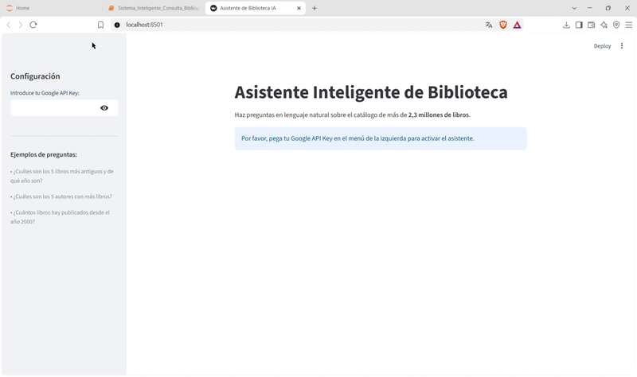

# Asistente IA de Consulta Bibliográfica (Text-to-SQL)

Proyecto de ingeniería de datos y desarrollo de agentes de Inteligencia Artificial aplicado a un catálogo masivo de la Biblioteca Nacional de España (BNE).

<p align="center">
  
</p>

## Funcionalidades
- **Limpieza de datos:** Limpieza de más de 2,3 millones de registros bibliográficos en Pandas, tratamiento de nulos y estandarización de fechas históricas.
- **Base de Datos Relacional:** Persistencia optimizada de los datos en SQLite (`biblioteca.db`).
- **Agente Text-to-SQL:** Integración con **Google Gemini (`gemini-3.8-flash`)** mediante LangChain para traducir preguntas en lenguaje natural a consultas SQL precisas.
- **Interfaz Web:** Aplicación interactiva desarrollada en **Streamlit**.

## Tecnologías Utilizadas
- **Python** (Pandas, SQLite3)
- **LangChain** & **Google GenAI API**
- **Streamlit** 
- **Jupyter Notebook** 

## Cómo ejecutar el proyecto localmente
Como el dataset original de la Biblioteca Nacional de España (BNE) contiene más de 2,3 millones de registros y supera los límites de tamaño para subirse directamente a GitHub, debes seguir estos pasos para preparar el entorno:

1. Descarga el dataset original: Obtén el archivo comprimido o CSV del catálogo de monografías modernas desde el portal oficial de datos abiertos de la BNE: https://datos.gob.es/es/catalogo/ea0019768-catalogo-bibliografico-monografias-modernas1
2. Clona este repositorio:
   ```bash
   git clone [https://github.com/jorgefgin/asistente-biblioteca-text-to-sql.git](https://github.com/jorgefgin/asistente-biblioteca-text-to-sql.git)

3. Instala las dependencias:
   ```bash
   pip install -r requirements.txt

4. Configura la ruta en tu entorno:  
   Coloca el archivo CSV descargado en tu ordenador y actualiza la variable de la ruta en la primera celda de tu cuaderno Jupyter    ```python
   ruta = r"C:\TuCarpeta\RutaHaciaTuArchivo\monomodernas-UTF8.csv"

5. Configura tu clave de API de Google (Se puede conseguir gratis en https://aistudio.google.com/?authuser=1)
6. Ejecuta la aplicación web:
   ```bash
   streamlit run app.py
